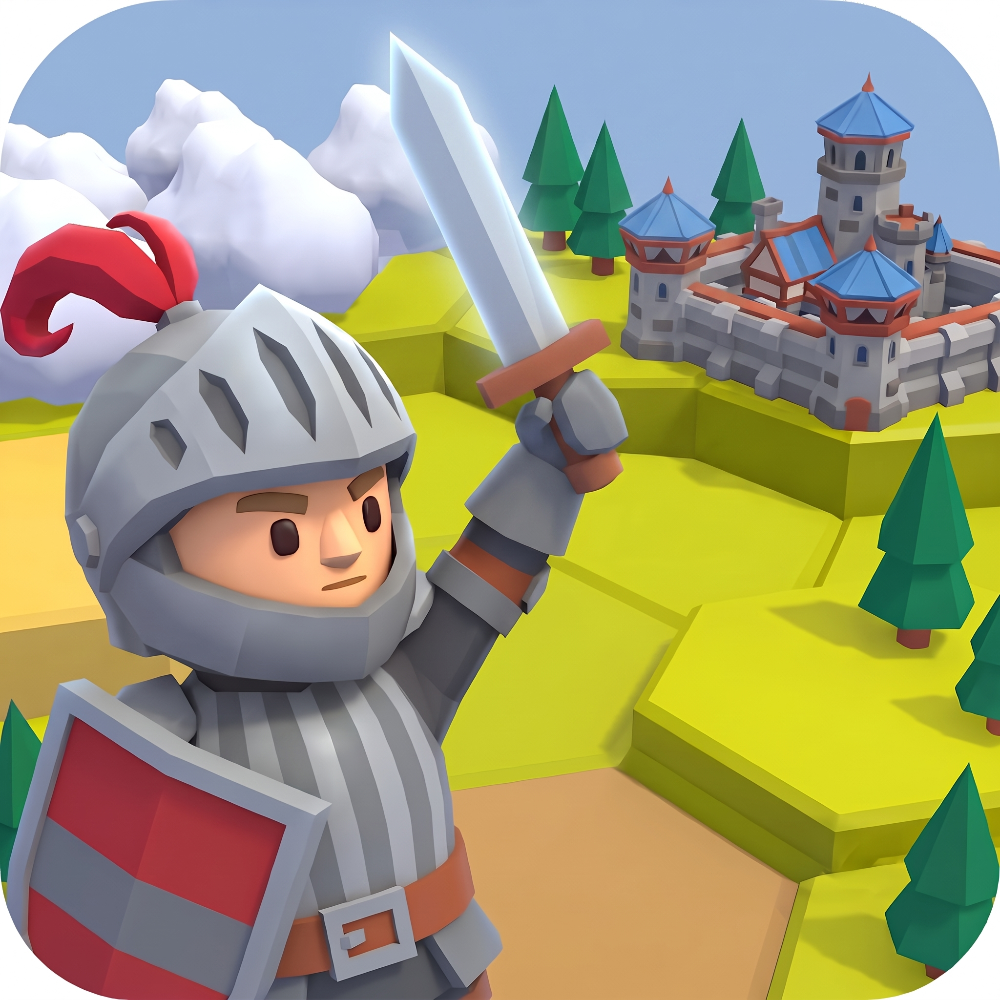

  <h1 align="left">
    
    
Endless Dungeon

  </h1>

**English** | [繁體中文](README.zh-TW.md) | [简体中文](README.zh-CN.md) | [日本語](README.ja.md) | [한국어](README.ko.md) | [Deutsch](README.de.md) | [Español](README.es.md)

A mobile-first (landscape) single-player roguelite: explore a hex map with height changes, fight with dice-based weapons, recruit companions, and grow across runs. Built with Godot 4 and GDScript.

## Status

- Current version: v0.1.0-alpha, a playable 3D hex roguelite with multi-floor and boss floors, dice combat, status effects, gear and backpack, enemy movement, recruitment and mercenaries, carry-over between floors, and local save and resume. The gold economy is not yet implemented.
- Playable web build: https://pluckyraven.eu.cc (backup: https://endlessdungeon-284529.gitlab.io)

## About this repository

This project is **closed source**. The source code, assets, and build scripts are not published here. This repository shows only the project's commit history (development timeline and contributors) and this README.

No part of this project may be copied, distributed, or modified without the author's written permission.

## Contributors

See [CONTRIBUTORS.md](CONTRIBUTORS.md).
